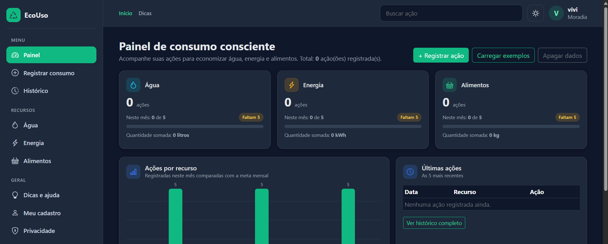
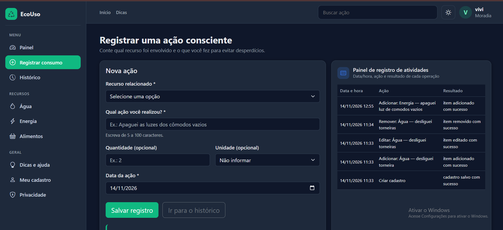
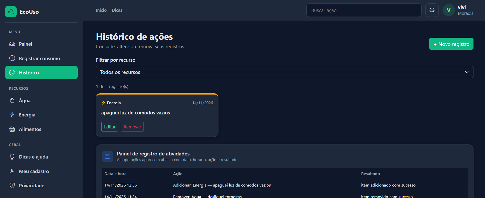
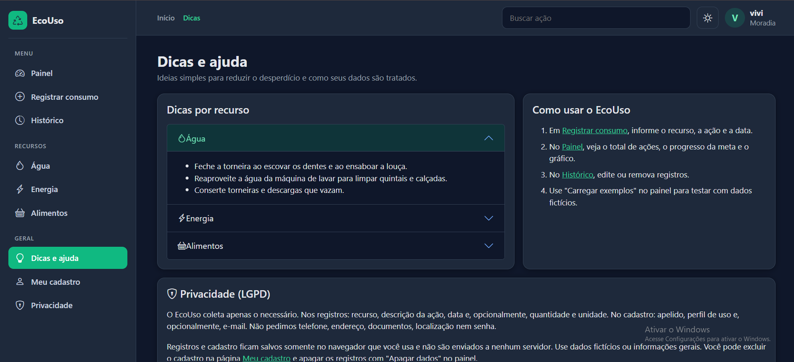
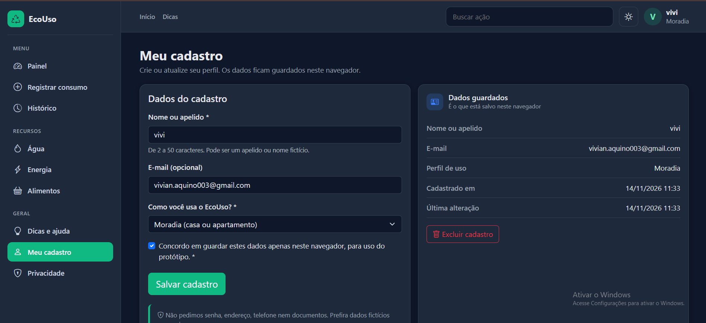

# EcoUso — Consumo consciente de recursos

## 1. Sobre o projeto

O **EcoUso** é um protótipo funcional de tecnologia cidadã para apoiar famílias e pequenos negócios na redução do desperdício de água, energia e alimentos. A pessoa registra atitudes sustentáveis, consulta o histórico e acompanha, em um painel com cartões e gráfico, a quantidade de ações por recurso em relação a uma meta mensal.

O projeto foi desenvolvido como atividade acadêmica de Desenvolvimento Web I (tema 5 — *Uso consciente de recursos*). Os dados são armazenados no `localStorage` do próprio navegador. Não existe servidor ou conta de usuário.

## 2. Problema e público afetado

- **Cidadãos afetados:** moradores de casas, apartamentos e pessoas responsáveis por pequenos comércios que desejam controlar hábitos de consumo.
- **Problema:** muitas atitudes de economia acontecem no dia a dia, mas não são registradas. Sem um histórico simples, fica difícil perceber a frequência dos hábitos e identificar onde melhorar.
- **Evidência que comprova o problema:** *(substitua por uma conversa real, observação própria ou dado público — não invente uma entrevista).* Exemplo de estrutura: "Conversei com [pessoa/tipo de comércio] em [data] e ela relatou que ...".
- **ODS relacionadas:** ODS 12 (Consumo e Produção Responsáveis), ODS 11 (Cidades e Comunidades Sustentáveis) e ODS 13 (Ação contra a Mudança Global do Clima).

## 3. Escopo da solução

O protótipo contempla três recursos: água, energia e alimentos. A pessoa pode fazer um cadastro simples (clicando na foto de perfil) e registrar ações, podendo informar quantidade e unidade. Há modo claro e modo noturno. O painel mostra o resumo por recurso (total, progresso da meta mensal e quantidade somada), um gráfico de barras e as últimas ações. O histórico permite listar, filtrar, editar e remover registros.

### Páginas

1. `index.html` — painel com cartões de resumo, gráfico e últimas ações.
2. `registrar.html` — formulário principal para cadastrar uma ação + painel de registro de atividades.
3. `historico.html` — listagem, filtro, edição (modal), remoção e painel de registro de atividades.
4. `dicas.html` — dicas por recurso, como usar e aviso de privacidade.
5. `cadastro.html` — cadastro do usuário (aberto pela foto de perfil), com os dados guardados no navegador.

## 4. Tecnologias utilizadas

- HTML5 semântico (`header`, `nav`, `main`, `section`, `article`, `aside` e `footer`).
- CSS externo em `css/style.css`, com **Flexbox** (menu, topbar, gráfico, cabeçalhos) e **CSS Grid** (estrutura menu + conteúdo e lista de cartões do histórico), abordagem Mobile First.
- Bootstrap 5.3 (CDN) para grid de cartões, formulários, tabelas, barras de progresso, accordion, alertas e modal; Bootstrap Icons (CDN) para os ícones.
- Modo noturno com `data-bs-theme="dark"` do Bootstrap + variáveis CSS próprias.
- JavaScript em dois arquivos: `js/app.js` (validação, DOM, operações CRUD, painel de atividades e modo noturno) e `js/cadastro.js` (cadastro do usuário).
- `localStorage` para manter os registros no mesmo navegador.
- Git e GitHub para versionamento.

## 5. Como executar

1. Baixe ou clone este repositório.
2. Abra a pasta do projeto no VS Code.
3. Abra `index.html` no navegador (recomenda-se a extensão Live Server).
4. A conexão com a internet é necessária para carregar o Bootstrap pelo CDN. O CSS e o JavaScript próprios ficam nos arquivos locais.

Não é necessário instalar dependências ou configurar banco de dados. Para testar rapidamente, clique em **Carregar exemplos** no painel (cria registros fictícios).

## 6. Estrutura de pastas


ecouso-prototipo/
├── index.html
├── registrar.html
├── historico.html
├── dicas.html
├── cadastro.html
├── README.md
├── imagens/
│   ├── pagina-inicial.png
│   ├── registro.png
│   ├── historico.png
│   ├── dicas.png
│   └── cadastro.png
├── css/
│   └── style.css
└── js/
    ├── app.js
    └── cadastro.js

## Telas do projeto

### Página inicial


### Página de registro


### Página de histórico


### Página de dicas


### Página de cadastro


## 7. Funcionalidades e operações JavaScript

- **Adicionar:** o formulário valida os campos e cria um novo registro (`adicionarRegistro`).
- **Listar:** o histórico lê os registros e cria cartões no DOM (`renderizarHistorico`); o painel mostra totais, gráfico e últimas ações (`renderizarPainel`).
- **Editar:** o botão abre um modal do Bootstrap já preenchido e atualiza o registro (`abrirEdicao` / `editarRegistro`).
- **Remover:** o botão pede confirmação e exclui o registro (`confirmarRemocao` / `removerRegistro`).
- **Painel de registro de atividades:** cada operação gera uma linha com data/hora, ação e resultado, por exemplo `13/11/2026 18:30 — item adicionado com sucesso` (`registrarAtividade` / `renderizarLog`); o cadastro também gera linhas no painel.
- **Filtros:** por recurso (select) e por texto (busca da barra superior).
- **Cadastro (`js/cadastro.js`):** a foto de perfil leva a `cadastro.html`. Os dados (nome/apelido, e-mail opcional, perfil de uso, consentimento e datas) são validados e guardados como **texto simples no formato `chave=valor`** no `localStorage` (chave `ecouso_cadastro_v2`), usando `objetoParaTexto()` e `textoParaObjeto()` do `app.js`. A página mostra uma lista com os dados salvos e permite **excluir** o cadastro. Não há senha.
- **Modo noturno:** o botão de lua/sol na barra superior alterna o tema; a escolha fica salva e, na primeira visita, segue a preferência do sistema.

Os dados ficam no `localStorage`, portanto permanecem após recarregar a página no mesmo navegador. Eles não são sincronizados entre dispositivos e podem ser apagados se os dados do navegador forem limpos.

## 8. Explicação do código

### HTML

Cada página possui a estrutura básica do HTML5, idioma `pt-BR`, codificação UTF-8 e `viewport`. O `aside` contém o menu lateral, o `header` traz a barra superior, o `main` reúne o conteúdo e o `footer` identifica o protótipo. Os links do menu permitem navegar entre as quatro páginas e há comentários marcando cada bloco.

Em `registrar.html`, cada campo tem `label` associado. Os atributos `required`, `minlength`, `maxlength`, `min`, `max` e `type` documentam as regras nativas do HTML5; o formulário usa `novalidate` para que o JavaScript exiba as mensagens de erro na tela, no próprio estilo do site. O `role="status"` e `aria-live` anunciam o retorno do formulário a leitores de tela.

### CSS

O arquivo `css/style.css` é dividido em seções numeradas (variáveis, base, estrutura, menu, topbar, cartões, gráfico, formulários, histórico, painel de atividades, rodapé e media queries). As cores ficam em variáveis em `:root`. O layout nasce pensado para telas pequenas (**Mobile First**): no celular o menu lateral vira uma "gaveta" aberta pelo botão de menu. As media queries são:

- **768px (tablet):** aparecem as abas e o nome do usuário na barra superior; os cartões do histórico ficam em 2 colunas.
- **992px (desktop):** o menu lateral passa a ocupar uma coluna fixa (Grid de duas colunas) e o botão de menu some.
- **1200px (desktop grande):** mais espaçamento, gráfico mais alto e cartões do histórico em 3 colunas.

### JavaScript

O arquivo `js/app.js` é dividido em 12 seções comentadas e o arquivo `js/cadastro.js` (carregado depois dele em todas as páginas) cuida só do cadastro, em 6 seções comentadas. `lerArmazenamento()` e `salvarArmazenamento()` acessam o navegador com `try/catch`, gravando cada item como uma linha de texto `chave=valor` (`objetoParaTexto()` / `textoParaObjeto()`). `validarRegistro()` valida todos os campos. `adicionarRegistro()`, `listarRegistros()`, `editarRegistro()` e `removerRegistro()` formam o CRUD. `criarCartao()` e `renderizarHistorico()` montam a lista com métodos do DOM. `renderizarCartoes()` e `renderizarGrafico()` montam o painel. `validarCadastro()`, `salvarCadastro()` e `excluirCadastro()` cuidam do cadastro. `aplicarTema()` e `alternarTema()` controlam o modo noturno. `iniciarAplicacao()` descobre em qual página está e liga só o que é necessário.

Os textos dos registros são inseridos usando `textContent`, evitando interpretar o conteúdo digitado como HTML.

## 9. Segurança e privacidade (LGPD)

- **Validação de toda entrada:** campo vazio, tamanho (ação de 5 a 100 caracteres), formato (data real) e tipo (quantidade numérica de 0 a 100000, recurso e unidade apenas das listas permitidas, data de 01/01/2020 até hoje; no cadastro, nome com 2 a 50 caracteres e caracteres permitidos, e-mail com formato válido e consentimento marcado). Os dados lidos do `localStorage` também são conferidos antes de serem usados.
- **Mensagens de erro sem detalhes internos:** se algo falhar, o usuário vê "Não foi possível carregar os dados. Tente novamente." (ou a versão de salvar). O detalhe técnico fica apenas no console.
- **Coleta mínima de dados:** o protótipo solicita somente o necessário. Nos registros: recurso, descrição da ação, data e quantidade/unidade opcionais. No cadastro: nome ou apelido, perfil de uso, e-mail (opcional) e consentimento. Não solicita senha, telefone, endereço, documentos ou localização. Os dados são fictícios ou gerais, e há aviso curto de privacidade no formulário.

**Aviso de privacidade:** registros e cadastro são armazenados localmente no navegador utilizado e não são enviados a um servidor. Quem compartilha o dispositivo pode visualizá-los. O botão "Apagar dados" do painel remove os registros e o botão "Excluir cadastro" remove o cadastro.

### Três ameaças e respectivas mitigações

1. **Entrada maliciosa no campo de descrição (XSS):** um texto poderia tentar inserir código na página. Mitigação: validar tamanho e tipo dos campos e inserir todo conteúdo com `textContent`/`createElement`, nunca com `innerHTML`.
2. **Acesso por outra pessoa ao mesmo dispositivo:** alguém com acesso ao navegador pode consultar os registros locais. Mitigação: coletar o mínimo de dados pessoais (sem senha, endereço ou documentos), orientar o uso em dispositivo próprio e oferecer os botões "Apagar dados" e "Excluir cadastro".
3. **Falha, bloqueio ou adulteração do armazenamento local:** o navegador pode impedir a gravação ou os dados salvos podem estar corrompidos. Mitigação: `try/catch` em toda leitura/gravação, descarte de itens com formato inválido, mensagem genérica ao usuário e nenhuma mensagem de sucesso quando a gravação falha.

## 10. Sustentabilidade como negócio de impacto

Uma possível continuidade seria oferecer o EcoUso gratuitamente para moradores e cobrar uma assinatura acessível de pequenos comércios, escolas ou associações para relatórios coletivos e acompanhamento de metas. Parcerias com cooperativas, organizações ambientais e órgãos locais poderiam apoiar oficinas de consumo consciente. A solução é escalável porque o custo de atender mais usuários é baixo (software), e o impacto cresce com a adesão de comunidades. A expansão deve ocorrer por etapas, avaliando a adesão e sem coletar dados pessoais desnecessários.

## 11. Testes responsivos

Teste cada página em três larguras pelo modo responsivo do navegador (F12 → ícone de celular/tablet):

- **Celular:** 375 px — menu escondido, botão de menu abre a gaveta, cartões em 1 coluna.
- **Tablet:** 768 px — abas e usuário aparecem, cartões do histórico em 2 colunas.
- **Desktop:** 1366 px — menu lateral fixo, cartões do histórico em 3 colunas, gráfico ao lado das últimas ações.

Teste também o modo noturno (botão de lua/sol) em cada largura. Confira se os campos cabem na tela e se as tabelas permitem rolagem horizontal quando necessário.

## 12. Roteiro de commits

O roteiro da atividade pede no mínimo **5 commits** com mensagens claras. Execute os comandos abaixo no terminal aberto na pasta do projeto (`ecouso-prototipo/`), um bloco de cada vez, para o histórico mostrar o desenvolvimento em etapas:

```bash
# 0) Cria o repositório e define o nome do usuário (só na primeira vez)
git init
git branch -M main
git config user.name "Seu Nome"
git config user.email "seu-email@exemplo.com"

# 1) Estilos
git add css/style.css
git commit -m "Adiciona estilos responsivos mobile first, menu lateral e modo noturno"

# 2) Painel inicial e dicas
git add index.html dicas.html
git commit -m "Cria painel inicial com cartões e gráfico e página de dicas com privacidade"

# 3) Registro e histórico
git add registrar.html historico.html
git commit -m "Adiciona formulário de registro e página de histórico com modal de edição"

# 4) Lógica principal em JavaScript
git add js/app.js
git commit -m "Implementa CRUD, validações, painel de atividades e modo noturno"

# 5) Cadastro e documentação
git add cadastro.html js/cadastro.js README.md
git commit -m "Adiciona cadastro do usuário e documenta o projeto e a segurança"
```

Depois, crie um repositório **público** vazio no GitHub (sem README) e envie:

```bash
git remote add origin https://github.com/SEU-USUARIO/ecouso-prototipo.git
git push -u origin main
```

Confira o histórico com `git log --oneline` (devem aparecer 5 commits). Se quiser mostrar mais evolução, faça commits extras depois (por exemplo, ao ajustar textos ou cores).

## 13. Limitações conhecidas

Este é um protótipo front-end: não mede automaticamente água, energia ou alimentos, não calcula economia financeira real e não possui autenticação, banco de dados remoto ou sincronização entre usuários. O cadastro não tem senha nem login: é apenas um perfil de demonstração guardado no navegador (um site sem servidor não grava arquivos nem bancos de dados; por isso os dados ficam só no navegador). A quantidade registrada é informada manualmente e não representa uma medição auditada. A meta mensal (5 ações por recurso) é um valor fixo de demonstração, definido na constante `RECURSOS` do `js/app.js`.
